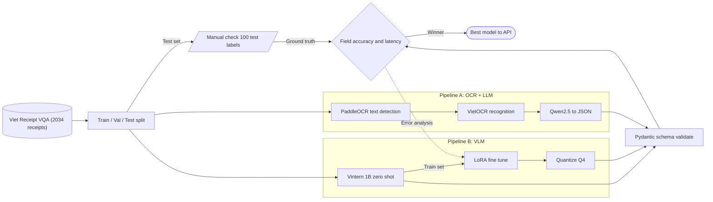
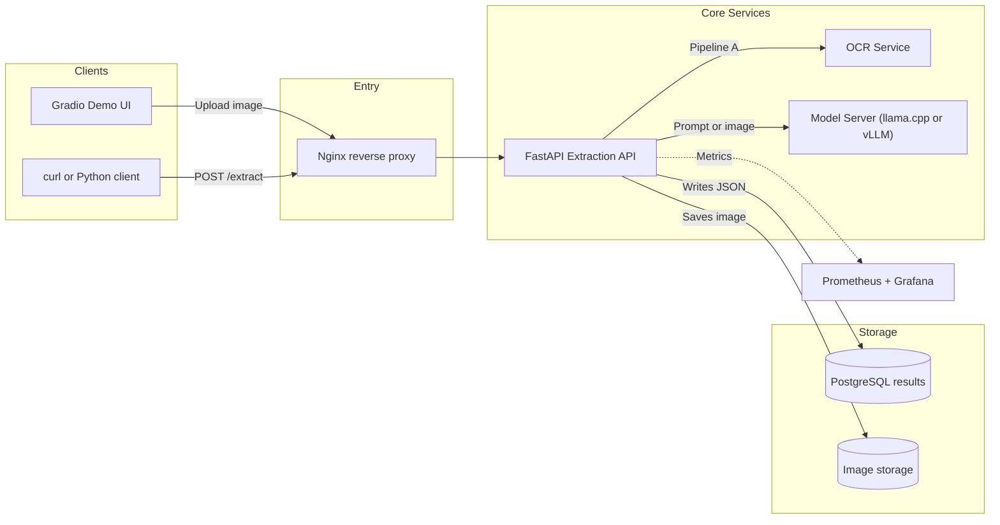

# Vietnamese Document Extraction API

Project plan cho CV AI Engineer. Tác giả: Trịnh Minh Khôi (Jack101005).

## 1. Tổng quan

**Bài toán:** người dùng gửi ảnh chụp hóa đơn bán lẻ tiếng Việt (chụp bằng điện thoại, có thể mờ, nghiêng, nhăn). Hệ thống trả về JSON có cấu trúc gồm tên cửa hàng, địa chỉ, ngày giờ, danh sách món, tổng tiền.

**Ví dụ output:**

```json
{
  "seller": "Bách Hóa Xanh",
  "address": "123 Nguyễn Văn Linh, Q7, TP.HCM",
  "timestamp": "2021-01-15 18:32",
  "items": [
    {"name": "Sữa tươi Vinamilk 1L", "qty": 2, "price": 32000}
  ],
  "total": 64000
}
```

**Mục tiêu thật sự của project:** không phải chỉ train một model, mà chứng minh bạn làm được cả vòng đời của một hệ thống AI:

1. So sánh hai kiến trúc một cách có số liệu (OCR + LLM so với VLM).
2. Có evaluation nghiêm túc trên test set do chính bạn kiểm tra.
3. Fine tune có lý do rõ ràng (dạy format output, không dạy kiến thức).
4. Tối ưu inference (quantization) và đo được cải thiện.
5. Đóng gói thành API chạy được, có Docker, CI, monitoring.

**Ràng buộc phần cứng:** MacBook Air 8GB RAM nên mọi bước nặng (chạy LLM 7B, fine tune, benchmark vLLM) làm trên Kaggle (GPU T4 x2, khoảng 30 giờ GPU mỗi tuần). Mac chỉ dùng để code, quản lý Git, và chạy bản demo với model đã quantize nhỏ.

## 2. Sơ đồ

Hai sơ đồ dưới đây đã được tạo trên FigJam, nằm trong Drafts của tài khoản Figma của bạn với tên **"VN Doc Extract: ML Pipeline"** và **"VN Doc Extract: System Architecture"**. Bạn có thể export PNG từ FigJam rồi bỏ vào thư mục `docs/` của repo. Bản Mermaid bên dưới sẽ tự render trên GitHub nên README luôn có sơ đồ kể cả khi chưa export ảnh.

### 2.1 ML Pipeline (training và evaluation)




### 2.2 System Architecture (khi deploy)




## 3. Tech stack

1. **Data:** Hugging Face `datasets`, dataset `5CD-AI/Viet-Receipt-VQA` (2034 ảnh hóa đơn lấy từ MC OCR 2021).
2. **OCR:** PaddleOCR (phát hiện vùng chữ), VietOCR (nhận dạng chữ tiếng Việt có dấu).
3. **LLM:** Qwen2.5 Instruct (bản 3B hoặc 7B lượng tử hóa 4 bit).
4. **VLM:** Vintern 1B (VLM tiếng Việt của 5CD-AI, xây trên InternVL).
5. **Fine tune:** `transformers`, `peft` (LoRA), `trl`.
6. **Validate output:** Pydantic.
7. **Tracking thí nghiệm:** Weights & Biases (free cho sinh viên) hoặc MLflow.
8. **Serving:** vLLM (benchmark trên Kaggle), llama.cpp với GGUF (demo trên Mac).
9. **Backend:** FastAPI, Uvicorn.
10. **Hạ tầng:** Docker, Docker Compose, Nginx, PostgreSQL.
11. **Monitoring:** Prometheus, Grafana.
12. **CI:** GitHub Actions (lint, unit test, build Docker image).
13. **Demo:** Gradio.

## 4. Cấu trúc repo

```
vn-doc-extract/
  README.md
  docs/                  sơ đồ, ảnh kết quả
  notebooks/             notebook Kaggle (EDA, baseline, finetune, benchmark)
  src/
    schema.py            Pydantic schema cho hóa đơn
    preprocess.py        xử lý ảnh, chuẩn hóa Unicode
    pipeline_ocr_llm.py  Pipeline A
    pipeline_vlm.py      Pipeline B
    api/main.py          FastAPI app
  eval/
    metrics.py           field accuracy, item F1, CER
    run_eval.py          chạy eval trên test set
    gold_test.jsonl      100 nhãn bạn tự kiểm tra
  tests/                 unit test cho schema, metrics, API
  docker/
    Dockerfile.api
    docker-compose.yml
  .github/workflows/ci.yml
```

## 5. Kế hoạch 4 tuần

Mỗi tuần khoảng 10 đến 12 giờ (làm buổi tối). Mỗi tuần kết thúc bằng một deliverable cụ thể và một commit có tag.

### Tuần 1: Data và baseline Pipeline A

1. Tạo repo, cấu trúc thư mục, notebook Kaggle bật GPU và Internet.
2. Tải dataset, EDA: xem phân bố số món, độ dài text, chất lượng ảnh, format của trường `extractions`.
3. Thiết kế schema Pydantic dựa trên format thật của dataset.
4. Chia train, val, test theo tỉ lệ khoảng 80, 10, 10 với seed cố định. Lưu danh sách id ra file để không bao giờ bị trộn lại.
5. Chọn 100 ảnh trong test, tự sửa nhãn bằng tay thành gold labels. Đây là việc chán nhất nhưng có giá trị nhất.
6. Viết `eval/metrics.py` trước khi có model (làm theo kiểu test first).
7. Chạy Pipeline A: PaddleOCR, VietOCR, Qwen2.5 với prompt kèm schema, temperature 0.
8. Ghi kết quả đầu tiên lên W&B.

**Deliverable:** bảng baseline Pipeline A trên gold test set. Tag `v0.1`.

### Tuần 2: Pipeline B và so sánh

1. Chạy Vintern 1B zero shot (không fine tune) với cùng prompt và schema.
2. Đo cả accuracy lẫn latency (thời gian mỗi ảnh) và VRAM.
3. Error analysis: lấy 30 mẫu sai nhiều nhất, phân loại lỗi (sai OCR, sai dấu, sai số tiền, sai format JSON, bịa thông tin).
4. Viết đoạn so sánh A và B trong README.

**Deliverable:** bảng so sánh A và B, kèm phân loại lỗi. Tag `v0.2`.

### Tuần 3: Fine tune và tối ưu

1. Chuẩn bị data train dạng hội thoại (ảnh + câu lệnh, câu trả lời là JSON chuẩn).
2. LoRA fine tune Vintern 1B trên tập train. Theo dõi loss train và val trên W&B.
3. Eval lại trên gold test, so với zero shot.
4. Quantize model đã fine tune (GGUF Q4 hoặc AWQ), eval lại để xem mất bao nhiêu accuracy.
5. Benchmark serving: vLLM trên Kaggle, đo throughput (ảnh mỗi giây) và latency p50, p95.

**Deliverable:** bảng "zero shot, LoRA, LoRA + quantize" với accuracy, latency, dung lượng model. Đẩy model lên Hugging Face Hub. Tag `v0.3`.

### Tuần 4: Production

1. FastAPI với endpoint `POST /extract` và `GET /health`, validate output bằng Pydantic, có retry khi JSON lỗi.
2. Ghi kết quả vào PostgreSQL, log thời gian xử lý.
3. Prometheus đếm request, lỗi, latency. Grafana dashboard.
4. Docker Compose cho API, Postgres, Prometheus, Grafana. Model server chạy native trên Mac (llama.cpp) để tiết kiệm RAM.
5. GitHub Actions: chạy lint, unit test, build image mỗi lần push.
6. Gradio demo, quay GIF demo bỏ vào README.
7. Hoàn thiện README: bài toán, sơ đồ, bảng kết quả, cách chạy, giới hạn.

**Deliverable:** repo hoàn chỉnh, demo chạy được bằng một lệnh. Tag `v1.0`.

### Lưu ý thời gian

1. Tải dataset (khoảng 460MB) mất vài phút, chỉ một lần mỗi session Kaggle.
2. Gán gold labels 100 ảnh: khoảng 3 đến 4 giờ, làm một lần.
3. LoRA fine tune trên T4: dự kiến 1 đến 3 giờ mỗi lần chạy. Nên chạy bằng "Save Version" của Kaggle để chạy nền, không cần mở trình duyệt.
4. Lần đầu build Docker image có PaddleOCR có thể mất 10 đến 15 phút, các lần sau nhanh nhờ cache.

## 6. Kiến thức AI sẽ dùng (giải thích kỹ)

### 6.1 OCR: phát hiện chữ và nhận dạng chữ

OCR hiện đại gồm hai bước tách biệt:

1. **Text detection:** tìm xem chữ nằm ở đâu trong ảnh, trả về các hộp bao quanh từng dòng chữ. PaddleOCR dùng thuật toán DB (Differentiable Binarization): một mạng CNN dự đoán cho mỗi pixel xác suất "đây là chữ", rồi biến bản đồ xác suất đó thành các vùng chữ. Điểm hay của DB là bước nhị phân hóa (chọn ngưỡng) được làm khả vi nên train cùng lúc với mạng.
2. **Text recognition:** cắt từng hộp ra và đọc chữ trong đó. VietOCR dùng kiến trúc CNN (trích đặc trưng ảnh) cộng với Transformer hoặc Seq2Seq có attention (sinh ra chuỗi ký tự). Lý do dùng VietOCR thay vì recognition mặc định của PaddleOCR: model tiếng Anh hay mất dấu, mà với tiếng Việt "Bánh" và "Banh" là hai từ khác nhau.

**Kiến thức rút ra:** pipeline nhiều giai đoạn thì lỗi cộng dồn. Nếu OCR đọc sai "64.000" thành "84.000" thì LLM giỏi đến đâu cũng sai. Đây là lý do chính để so sánh với VLM.

### 6.2 LLM và structured output

Sau OCR ta có một đống text lộn xộn. LLM có nhiệm vụ hiểu ngữ cảnh và sắp xếp thành JSON.

1. **Prompt engineering:** đưa vào prompt schema JSON, vài ví dụ mẫu (few shot), và quy tắc rõ ràng (ví dụ "tiền là số nguyên, không có dấu chấm"). Đặt temperature bằng 0 để output ổn định, lặp lại được.
2. **Constrained decoding:** thay vì hy vọng model xuất đúng JSON, ta ép nó. Ở mỗi bước sinh token, chỉ cho phép những token giữ cho output còn hợp lệ theo grammar. llama.cpp hỗ trợ việc này qua GBNF grammar, vLLM hỗ trợ qua guided decoding. Kết quả: tỉ lệ JSON lỗi gần như bằng 0.
3. **Validation:** Pydantic kiểm tra kiểu dữ liệu và ràng buộc (ví dụ tổng tiền phải lớn hơn 0, ngày phải parse được). Nếu sai thì retry với prompt kèm thông báo lỗi.

**Kiến thức rút ra:** trong production, độ tin cậy của output quan trọng ngang độ chính xác.

### 6.3 Vision Language Model (VLM)

VLM đọc thẳng ảnh, bỏ qua bước OCR riêng. Cấu trúc gồm ba phần:

1. **Vision encoder** (thường là một Vision Transformer, ViT): chia ảnh thành các mảnh nhỏ (patch), mỗi mảnh thành một vector.
2. **Projector:** một mạng nhỏ (thường là MLP) chuyển các vector ảnh sang cùng không gian với embedding của text, để LLM "hiểu" được chúng như những token.
3. **LLM:** nhận chuỗi token gồm cả token ảnh lẫn token câu lệnh, rồi sinh câu trả lời.

Dòng InternVL (Vintern dựa trên đó) chia ảnh độ phân giải cao thành nhiều ô (tiling) để không mất chi tiết chữ nhỏ. Đổi lại, nhiều ô thì nhiều token, chậm hơn và tốn VRAM hơn. Đây là một trade off bạn sẽ đo được.

**Kiến thức rút ra:** VLM tránh được lỗi cộng dồn của OCR, nhưng có thể "bịa" (hallucinate) chữ không có trong ảnh. Error analysis sẽ cho bạn thấy rõ điều này.

### 6.4 Transfer learning, fine tuning và LoRA

1. **Transfer learning:** Vintern đã học được cách đọc chữ tiếng Việt trong ảnh. Ta chỉ cần dạy nó thêm một việc hẹp: xuất đúng schema JSON của mình.
2. **Vì sao fine tune ở đây là đúng:** fine tune thay đổi hành vi và format, không phải cách tốt để nạp kiến thức mới (việc đó là của RAG). Bài toán này đúng là vấn đề format: model đã đọc được chữ, chỉ cần học cách trình bày.
3. **LoRA (Low Rank Adaptation):** thay vì cập nhật toàn bộ ma trận trọng số W (hàng triệu tham số), ta giữ W đứng yên và học thêm hai ma trận nhỏ A và B sao cho phần thay đổi là B nhân A. Nếu W có kích thước 2048 x 2048 và rank r bằng 16 thì chỉ học khoảng 65 nghìn tham số thay vì 4 triệu. Kết quả: train được trên T4, file adapter chỉ vài chục MB.
4. **Các siêu tham số chính:** rank r, alpha (hệ số scale), learning rate, số epoch, và áp LoRA vào lớp nào (thường là các lớp attention q, k, v, o).
5. **Overfitting:** dataset chỉ khoảng 1600 mẫu train nên dễ học vẹt. Theo dõi val loss, dừng sớm khi val loss tăng.

### 6.5 Evaluation

Phần này là thứ phân biệt project sinh viên với project của kỹ sư.

1. **Field level accuracy:** với mỗi trường (seller, total, timestamp...) so sánh dự đoán với nhãn sau khi chuẩn hóa (bỏ khoảng trắng thừa, chuẩn hóa Unicode, chuẩn hóa số). Báo cáo riêng từng trường vì mỗi trường khó khác nhau.
2. **Item level F1:** danh sách món là một tập hợp, có thể thiếu hoặc thừa. Ghép cặp món dự đoán với món thật rồi tính precision, recall, F1.
3. **CER (Character Error Rate):** đo lỗi ở mức ký tự cho các trường text, cho thấy model sai "một chút" hay sai hẳn.
4. **Silver labels và gold labels:** nhãn của dataset do model sinh ra (silver), có thể sai. Nếu chỉ eval trên silver thì bạn đang đo "model của mình giống model kia bao nhiêu", không phải đo độ đúng. 100 gold labels tự kiểm tra giải quyết việc này. Đây là một câu chuyện rất hay để kể khi phỏng vấn.
5. **Data leakage:** test set phải cố định từ ngày đầu và không bao giờ dùng để chọn prompt hay siêu tham số. Dùng val cho việc đó.
6. **Error analysis:** con số trung bình không nói lên được nhiều. Phân loại lỗi mới cho biết cần sửa ở đâu.

### 6.6 Quantization

1. **Ý tưởng:** trọng số model mặc định lưu ở 16 bit. Quantization nén xuống 8 bit hoặc 4 bit, giảm dung lượng 2 đến 4 lần và thường tăng tốc độ.
2. **Cách làm:** chia trọng số thành nhóm nhỏ, mỗi nhóm lưu một hệ số scale, rồi làm tròn từng giá trị về số nguyên ít bit. Sai số làm tròn chính là nguồn mất accuracy.
3. **GGUF** (dùng với llama.cpp): chạy tốt trên CPU và Apple Silicon, rất hợp cho bản demo trên Mac.
4. **AWQ** (Activation aware Weight Quantization): giữ chính xác hơn những trọng số quan trọng (dựa trên activation), dùng tốt với vLLM trên GPU.
5. **Trade off cần đo:** accuracy giảm bao nhiêu, đổi lại latency giảm bao nhiêu và RAM giảm bao nhiêu.

### 6.7 Inference serving

1. **KV cache:** khi sinh token, model lưu lại key và value của các token trước để không tính lại. Đây là thứ chiếm nhiều VRAM nhất khi serving.
2. **PagedAttention (vLLM):** quản lý KV cache theo từng trang nhỏ giống bộ nhớ ảo của hệ điều hành, giảm lãng phí bộ nhớ. Kiến thức OS bạn đang học ở xv6 áp dụng thẳng vào đây.
3. **Continuous batching:** gộp nhiều request đang chạy vào cùng một batch, request nào xong thì request mới vào ngay. Tăng throughput rất nhiều so với xử lý tuần tự.
4. **Các chỉ số:** latency p50 và p95 (người dùng chờ bao lâu), throughput (bao nhiêu ảnh mỗi giây), time to first token.
5. **Lưu ý về T4:** T4 không hỗ trợ tốt bf16, nên dùng fp16 khi chạy trên Kaggle.

### 6.8 MLOps và production

1. **Experiment tracking:** mọi lần chạy đều log config, metric, version data lên W&B để so sánh và tái lập được.
2. **Reproducibility:** cố định seed, cố định version thư viện trong `requirements.txt`, lưu danh sách id của từng split.
3. **Docker:** đóng gói môi trường để "chạy trên máy tui được" cũng có nghĩa là chạy được ở mọi nơi.
4. **CI:** mỗi lần push tự chạy test, bắt lỗi trước khi merge.
5. **Monitoring:** đếm request, lỗi, latency. Trong thực tế còn theo dõi data drift (ảnh đầu vào thay đổi so với lúc train), có thể ghi vào phần hướng phát triển.
6. **Graceful failure:** khi model trả JSON lỗi hoặc ảnh không phải hóa đơn, API phải trả lỗi rõ ràng chứ không sập.

### 6.9 Xử lý dữ liệu tiếng Việt

1. **Chuẩn hóa Unicode NFC:** chữ "ế" có thể được lưu bằng một ký tự dựng sẵn hoặc bằng chữ "e" cộng các dấu tổ hợp. Nhìn giống hệt nhau nhưng so sánh chuỗi sẽ ra khác. Phải chuẩn hóa về NFC ở cả dự đoán lẫn nhãn trước khi tính metric, nếu không accuracy sẽ thấp oan.
2. **Chuẩn hóa số tiền:** "64.000", "64,000", "64000đ" đều là 64000.
3. **Tiền xử lý ảnh:** xoay thẳng ảnh nghiêng, resize về kích thước phù hợp, có thể tăng tương phản cho ảnh mờ.

## 7. Rủi ro và cách xử lý

1. **Nhãn silver sai nhiều:** đã có gold test set. Nếu sai quá nhiều, có thể lọc bớt mẫu train có nhãn đáng ngờ.
2. **Hết quota GPU Kaggle:** ưu tiên chạy thí nghiệm nhỏ trên tập con trước, chỉ chạy full khi đã chắc code đúng.
3. **Mac 8GB không chạy nổi demo:** dùng model đã quantize Q4 (khoảng 1GB với model 1B), chạy model server native thay vì trong Docker. Nếu Vintern chưa có bản GGUF chạy được với llama.cpp, demo dùng Pipeline A với Qwen2.5 1.5B hoặc 3B bản GGUF. Kiểm tra việc này sớm ở tuần 2.
4. **Vintern xử lý ảnh dài kém:** thử tăng số ô (tiling) hoặc cắt ảnh hóa đơn dài thành nhiều phần.
5. **Dữ liệu nhạy cảm:** hóa đơn có thể chứa tên, số điện thoại. Không commit ảnh gốc lên GitHub, chỉ để link dataset.

## 8. Viết vào CV như thế nào

Điền số thật sau khi làm xong. Mẫu:

**Vietnamese Receipt Extraction API** (Python, PyTorch, FastAPI, vLLM, Docker)

1. Built an extraction system converting Vietnamese receipt photos into validated JSON; compared an OCR plus LLM pipeline against a VLM approach on a manually verified test set.
2. Fine tuned Vintern 1B with LoRA, raising field accuracy from X% to Y%; 4 bit quantization cut model size by Z times with under W points accuracy loss.
3. Served the model behind FastAPI with constrained JSON decoding, Prometheus and Grafana monitoring, Docker Compose deployment, and GitHub Actions CI.

## 9. Checklist hoàn thành

1. Repo public, README có sơ đồ, bảng kết quả, GIF demo.
2. Gold test set 100 mẫu nằm trong repo.
3. Ít nhất 4 cấu hình được so sánh: Pipeline A, VLM zero shot, VLM LoRA, VLM LoRA quantize.
4. Model fine tune đã đẩy lên Hugging Face Hub.
5. `docker compose up` chạy được toàn bộ hệ thống.
6. CI xanh.
7. Mục "Limitations" ghi rõ hệ thống làm chưa tốt ở đâu.
